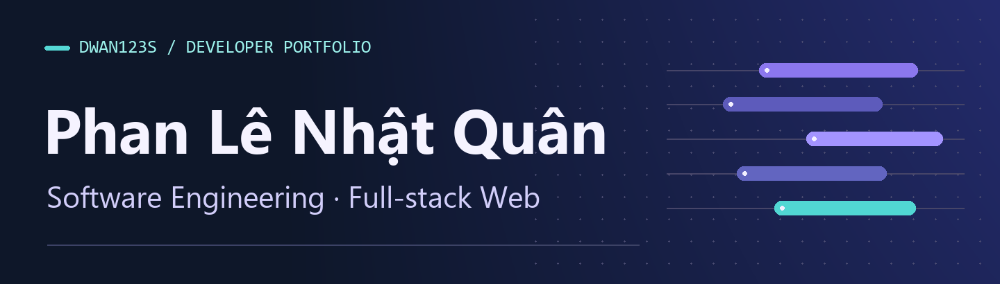
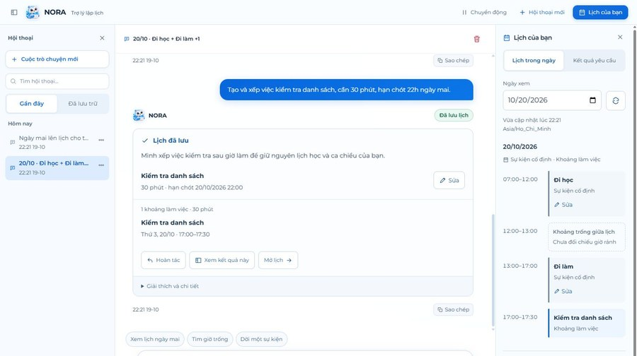
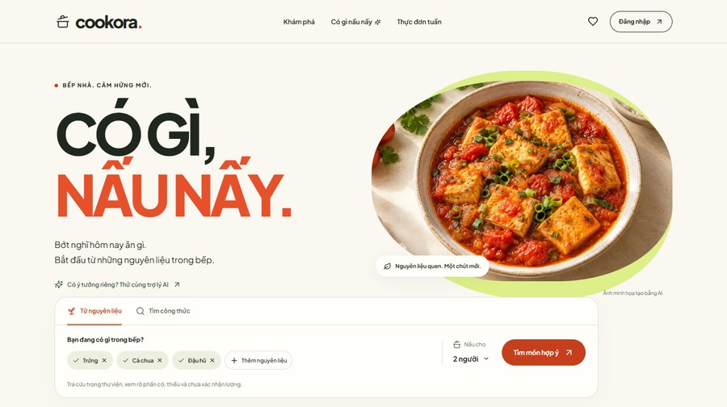

  

  <a href="#du-an">Dự án</a> &nbsp;·&nbsp;
  <a href="#cong-nghe">Công nghệ</a> &nbsp;·&nbsp;
  <a href="#hoc-van-thanh-tich">Học vấn &amp; thành tích</a>

Mình là **Quân**, sinh viên **Kỹ thuật phần mềm tại Đại học FPT – Đà Nẵng**, định hướng **Full-stack Developer**. Mình thích xây dựng sản phẩm web từ giao diện đến API và cơ sở dữ liệu. Các dự án dưới đây đi từ bài toán lập lịch cá nhân đến gợi ý món ăn theo nguyên liệu, đặt lịch chụp ảnh và theo dõi dữ liệu cảm biến.

## Dự án nổi bật

<table>
  <tr>
    <td width="50%" valign="top">
      
      <h3>PLANORA</h3>
      
<strong>Lập lịch công việc cá nhân</strong>

      
Mình xây dựng thuật toán xếp lịch theo hạn chót, độ ưu tiên, thời gian rảnh và phụ thuộc giữa các công việc. Trợ lý NORA đọc yêu cầu tiếng Việt, đề xuất lịch để xem trước và hỗ trợ điều chỉnh hoặc hoàn tác.

      
<code>C#</code> <code>ASP.NET Core</code> <code>EF Core</code> <code>SQL Server</code> <code>React</code>

      <a href="https://github.com/Dwan123s/SPWPOS">Mã nguồn &amp; tài liệu ↗</a>
    </td>
    <td width="50%" valign="top">
      
      <h3>Cookora · Bếp Nhà</h3>
      
<strong>Tìm món theo nguyên liệu và ngân sách</strong>

      
Ứng dụng lọc món theo nguyên liệu có sẵn, quy đổi định lượng theo khẩu phần và dùng Vertex AI để gợi ý thực đơn từ công thức trong danh mục. Bản web chạy trên Vercel và Neon PostgreSQL.

      
<code>TypeScript</code> <code>React</code> <code>NestJS</code> <code>Prisma</code> <code>PostgreSQL</code>

      <a href="https://cookora-rose.vercel.app">Mở demo ↗</a> · <a href="https://github.com/Dwan123s/Cookora">Mã nguồn ↗</a>
    </td>
  </tr>
</table>

### Vũ Phạm Studio · Website dịch vụ nhiếp ảnh

Mình phát triển giao diện responsive cho website giới thiệu dịch vụ và bảng giá, đồng thời xây dựng luồng đặt lịch trực tuyến và tra cứu ảnh thẻ theo mã khách hàng.

**HTML · CSS · JavaScript** 
[Website ↗](https://www.vuphamstudio.com) · [Mã nguồn website ↗](https://github.com/Dwan123s/VUPHAMSTUDIO) · [Mã nguồn tra cứu ↗](https://github.com/Dwan123s/VPSTUDIO)

### RainSense · Giám sát lượng mưa và môi trường

ESP32-S3 thu dữ liệu từ cảm biến môi trường và phễu lật đo mưa. Backend nhận bản tin MQTT, lưu dữ liệu vào PostgreSQL và đẩy cập nhật theo thời gian thực lên dashboard qua Socket.IO.

**ESP32-S3 · MQTT · Express · Socket.IO · Next.js · PostgreSQL** 
[Mã nguồn & kiến trúc ↗](https://github.com/Dwan123s/RainFall)

  
<strong>Dự án khác</strong>

  - [Học Cùng AI](https://github.com/Dwan123s/HoccungAI) · Giao diện web cho trợ lý học tập.
  - [Smart Weather Station](https://github.com/Dwan123s/weather-station) · Trạm ESP32-S3 đo nhiệt độ, độ ẩm, áp suất, tốc độ và hướng gió, truyền dữ liệu qua MQTT.
  - [Tất cả kho mã nguồn](https://github.com/Dwan123s?tab=repositories)

## Công nghệ

| Mảng | Công nghệ đã học hoặc dùng trong dự án |
| :--- | :--- |
| **Ngôn ngữ** | C#, JavaScript, TypeScript, Java, C |
| **Frontend** | HTML5, CSS3, React, Next.js, Tailwind CSS, responsive design |
| **Backend & API** | .NET, ASP.NET Core Web API, EF Core, NestJS, Express, REST, Firebase Authentication |
| **Cơ sở dữ liệu** | SQL Server, PostgreSQL, MongoDB, Prisma |
| **Công cụ** | Git, GitHub, Visual Studio, VS Code, Docker, Vercel |

## Học vấn & thành tích

**Đại học FPT – Đà Nẵng** · Kỹ thuật phần mềm · Từ 2024 
Lập trình hướng đối tượng, cấu trúc dữ liệu và giải thuật, cơ sở dữ liệu, phân tích thiết kế và kiểm thử phần mềm.

- **AI for Impact** · Top 8 vòng sơ loại và tham gia vòng chung kết.
- **Resconnect 2026** · Tham gia vòng sơ loại.
- **Web Design** · Lọt vòng ý tưởng.
